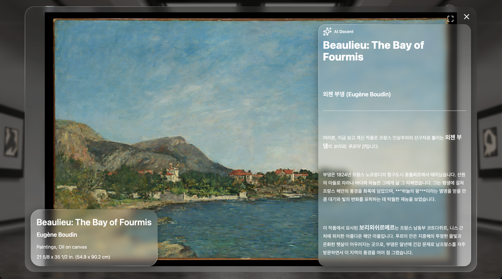

# MuseOn


**작품을 넘기며 감상하고, AI 도슨트의 해설로 이야기를 발견하는 온라인 미술관**

**An online museum where you explore artworks and discover their stories with an AI docent.**

onMuseum은 메트로폴리탄 미술관의 컬렉션 데이터를 활용한 웹 전시 서비스입니다. 작품을 탐색하는 과정에 다양한 인터랙션을 더해, 사용자가 웹에서도 전시를 둘러보는 즐거움을 느끼고 작품 감상에 몰입할 수 있도록 했습니다.

onMuseum is a web-based exhibition service powered by collection data from The Metropolitan Museum of Art. Interactive elements throughout the browsing experience invite visitors to enjoy exploring an exhibition and immerse themselves in art on the web.

부서별 전시와 키워드 검색으로 작품을 탐색하고, 작품 정보와 Claude 기반 해설을 함께 살펴볼 수 있습니다.

Browse artworks by department or keyword, and explore artwork details alongside Claude-powered commentary.

커버플로 슬라이더와 작품 확대 보기를 통해 웹에서도 작품 감상에 집중할 수 있는 경험을 구현했습니다.

A Coverflow slider and an expanded artwork view create an experience that keeps the focus on the art.

## 서비스 바로가기 | Live Demo

https://gorgeous-kangaroo-5530c0.netlify.app/

## 주요 기능 | Key Features

- **스크롤 기반 3D 랜딩 페이지**  
  우주 배경에서 스크롤에 따라 작품이 나타나는 연출로, 시간과 공간을 여행하는 듯한 경험을 제공합니다.

- **부서별 작품 탐색**  
  메트로폴리탄 미술관의 컬렉션을 부서별로 둘러보고, 입체적인 슬라이더로 작품을 감상할 수 있습니다.

- ~~**키워드 검색**  
  검색어를 입력해 관심 있는 작품을 찾아볼 수 있습니다.~~
  (Met API ```/v1/search``` 2026.10. 부로 종료)

- **작품 확대 및 상세 정보 확인**  
  작품을 확대해 감상하고, 작가·시대·재료·크기 등의 정보를 확인할 수 있습니다.

- **AI 도슨트 해설**  
  Claude 기반의 작품 해설을 통해 작품에 담긴 이야기와 배경을 살펴볼 수 있습니다.

- **연속적인 작품 탐색**  
  탐색 중 다음 작품 데이터를 미리 불러와 페이지 이동 없이 감상을 이어갈 수 있습니다.
  
  ---
- **Scroll-Driven 3D Landing Page**  
  Artworks appear against a cosmic backdrop as you scroll, creating the feeling of traveling through time and space.

- **Browse Artworks by Department**  
  Explore The Metropolitan Museum of Art’s collection by department and view artworks in a slider with a sense of depth.

- ~~**Keyword Search**~~  
  ~~Enter a keyword to find artworks that interest you.~~  
  (The Met API `/v1/search` endpoint was discontinued in October 2026.)

- **Expanded Artwork View and Details**  
  View artworks at a larger size and explore details such as the artist, period, medium, and dimensions.

- **AI Docent Commentary**  
  Discover the stories and context behind artworks through Claude-powered commentary.


- **Continuous Artwork Browsing**  
  Upcoming artwork data is prefetched as you browse, letting you continue exploring without switching pages.

## 주요 화면 구성 | Page Overview
### 랜딩 페이지 | Landing Page


과거와 현재를 잇는 예술이라는 서비스의 콘셉트를 전달하기 위해, 랜딩 페이지를 우주 배경으로 구성했습니다. 스크롤에 따라 작품이 차례로 나타나도록 연출해, 사용자가 시간과 공간을 여행하며 예술을 만나는 듯한 경험을 담았습니다.

The landing page uses a cosmic backdrop to express the service’s concept of art connecting the past and present. Artworks appear one after another as visitors scroll, creating the feeling of encountering art on a journey through time and space.


```Three.js```와 GSAP ```ScrollTrigger```를 활용해 스크롤 기반의 3D 랜딩 페이지를 구현했습니다. 우주 공간에 배치된 작품과 카메라의 움직임을 스크롤에 연동하고, 마우스 움직임에 반응하는 패럴랙스 효과를 더해 시간과 공간을 여행하며 작품을 만나는 듯한 경험을 연출했습니다.

The scroll-driven 3D landing page is built with `Three.js` and GSAP’s `ScrollTrigger`. Artwork and camera movements in the cosmic scene are synchronized with scrolling, while a mouse-responsive parallax effect adds to the sense of traveling through time and space.

### 전시관 페이지 | Exhibition Hall
해당 페이지의 디자인 컨셉은 작품의 상세정보를 포함하면서도 작품 감상에 방해가 되지 않도록 Apple의 liquid glass 스타일을 차용했습니다.

Inspired by Apple’s Liquid Glass style, the exhibition hall presents artwork details while keeping the art itself in focus.


```Swiper```의 ```Coverflow``` 효과를 활용해 작품을 입체적으로 탐색할 수 있는 전시관을 구현했습니다. ```TanStack Query```의 무한 쿼리로 작품을 점진적으로 불러오고, 탐색 중 다음 데이터를 미리 요청하도록 구성했습니다. 또한 ```GSAP``` 기반의 ```Marquee``` 애니메이션으로 긴 작품 정보를 표시하고, 스켈레톤 UI로 로딩 상태를 안내했습니다.

The exhibition hall uses `Swiper`’s `Coverflow` effect to give artwork browsing a sense of depth. Infinite queries in `TanStack Query` load artworks progressively and fetch upcoming data as visitors browse. A `GSAP`-based marquee animation displays long artwork details, while skeleton placeholders indicate loading states.

### 작품 상세보기와 AI 도슨트 | Artwork Details and AI Docent



작품의 **Expand** 버튼을 클릭하면 작품을 확대해 감상할 수 있는 모달이 열립니다.

Clicking an artwork’s **Expand** button opens a modal for viewing the artwork at a larger size.

모달에서는 작품의 상세 정보와 Claude 기반의 AI 도슨트 해설을 확인할 수 있습니다. 작품 전체 화면 보기에서도 동일한 기능을 이용할 수 있으며, AI 도슨트 패널은 버튼으로 숨기거나 다시 표시할 수 있습니다.

The modal provides artwork details and Claude-powered AI docent commentary. The same features are available in fullscreen view, and visitors can hide or show the AI docent panel using a button.

## 기술 스택 | TECHNICAL SKILLS

### Frontend

| 기술  Technology | 사용 목적  Purpose |
| --- | --- |
| React · TypeScript | 컴포넌트 기반 UI 개발 및 타입 관리<br>Component-based UI development and type checking |
| Vite | 개발 서버 및 프로덕션 빌드<br>Development server and production builds |
| React Router | 페이지 이동 및 검색 URL 관리<br>Page navigation and search URL management |
| Tailwind CSS · CSS | UI 스타일링 및 Liquid Glass 효과<br>UI styling and Liquid Glass effects |
| TanStack Query | 서버 데이터 캐싱 및 커서 기반 추가 로딩<br>Server-state caching and cursor-based pagination |

### 인터랙션 및 UI | Interactions and UI

| Technology | Purpose |
| --- | --- |
| Three.js | 랜딩 페이지의 3D 작품 배치와 우주 배경 구현<br>3D artwork placement and cosmic background on the landing page |
| GSAP · ScrollTrigger | 스크롤 연동 애니메이션, 작품 정보 마키 및 텍스트 효과<br>Scroll-linked animations, artwork information marquees, and text effects |
| Framer Motion | 헤더 메뉴의 등장·퇴장 애니메이션<br>Header menu enter and exit animations |
| Swiper | Coverflow 효과를 활용한 작품 슬라이더<br>Artwork slider with the Coverflow effect |
| React Loading Skeleton | 데이터 로딩 중 스켈레톤 UI 표시<br>Skeleton placeholders during data loading |
| React Markdown · remark-gfm | AI 도슨트 해설의 마크다운 렌더링<br>Markdown rendering for AI docent commentary |
| Lucide React | UI 아이콘<br>UI icons |

### Backend 및 외부 API | Backend and External APIs

| Technology | Purpose |
| --- | --- |
| Node.js · Express | 작품 조회·검색 및 AI 해설 API 서버<br>API server for artwork retrieval, search, and AI commentary |
| Upstash Redis | 미술관 부서·작품 목록·상세 데이터 캐싱<br>Caching museum departments, artwork lists, and artwork details |
| Claude API | 작품 정보 기반 AI 도슨트 해설 생성<br>Generating AI docent commentary based on artwork information |
| The Metropolitan Museum of Art Collection API | 작품 및 부서 데이터 제공<br>Providing artwork and department data |

### 개발 도구 | Development Tools

| Technology | Purpose |
| --- | --- |
| Figma | 디자인<br>Design |
